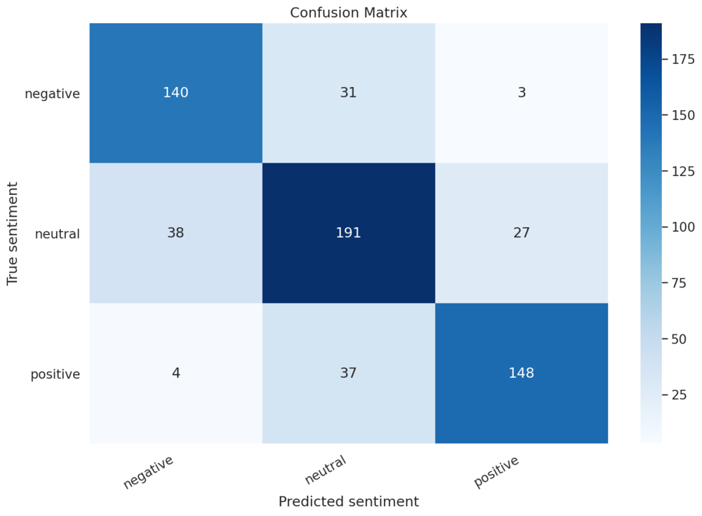
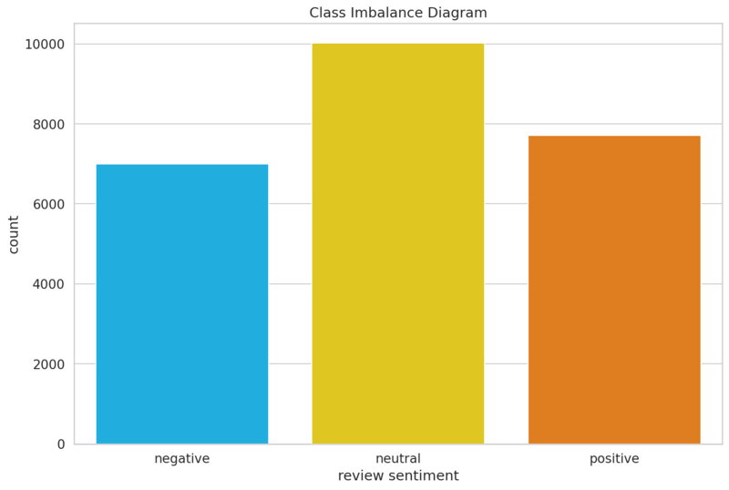
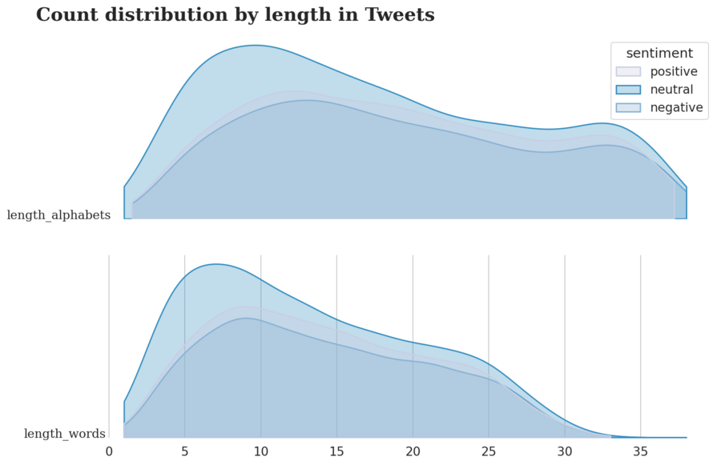
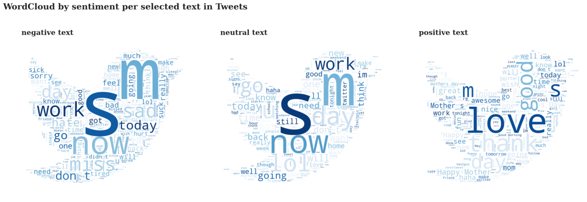
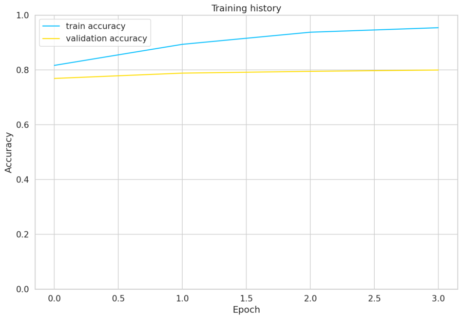

# Analyse de sentiment de tweets : de BERT à Twitter RoBERTa

Classification automatique de tweets en trois classes (négatif, neutre, positif).
Le projet est parti d'un challenge de cours (BERT fine-tuné, 2024). Il a été repris en 2026 avec un protocole reproductible sur données publiques, un modèle pré-entraîné sur des tweets, un export ONNX quantifié et une démo web.

**Résultat actuel : Twitter RoBERTa fine-tuné, accuracy 81,0 % et F1 macro 0,813** sur le jeu de test officiel de *Tweet Sentiment Extraction* (3 534 tweets). La baseline BERT, réentraînée avec la recette du cours sur le même split, obtient 79,0 % et 0,793. Source : `training/metrics.json`.

> Projet académique d'origine réalisé en équipe de quatre dans le cadre du cours *Algorithmic Machine Learning* (AML), challenge 3, printemps 2024 (voir [Résultat historique du challenge](#résultat-historique-du-challenge-2024)).

---

## Démo en ligne

Une page web permet de taper ou coller un texte en anglais, ou de cliquer sur un exemple (sarcasme, négation, avis mitigé…). Elle affiche la classe, les probabilités des trois classes en barres et le temps d'inférence. Un mode « lot » analyse jusqu'à 50 lignes d'un coup (saisies ou importées d'un fichier `.txt`) et présente le résultat en tableau.

La démo existe en deux versions : une version **statique, en ligne**, où le modèle tourne entièrement dans le navigateur du visiteur (aucun texte n'est envoyé à un serveur), et une version **API FastAPI / Docker, à lancer en local**.

- **En ligne** : <https://elliotbch.github.io/Sentiment-analysis/>. Site statique (dossier [`site/`](site/), publié sur GitHub Pages par [`.github/workflows/pages.yml`](.github/workflows/pages.yml)) : le modèle ONNX INT8 (120 Mo) et le tokenizer sont téléchargés depuis le Hub Hugging Face ([`elliotb/sentiment-twitter-roberta`](https://huggingface.co/elliotb/sentiment-twitter-roberta)) une seule fois, puis gardés en cache par le navigateur, et exécutés avec ONNX Runtime Web (WebAssembly), en environ 0,1 s par tweet. La tokenisation et la normalisation des tweets reproduisent exactement celles de l'API (vérifié sur 31 048 tweets, voir [`site/tests/`](site/tests/)) ; les probabilités peuvent différer de quelques millièmes de celles de l'API, car le modèle quantifié en INT8 amplifie les infimes écarts de calcul entre le CPU natif et WebAssembly.
- **En local (API)**, une fois le modèle exporté (voir [`training/README.md`](training/README.md)) :
  ```bash
  python -m venv .venv-demo && source .venv-demo/bin/activate
  pip install -r demo/requirements.txt
  cd demo && uvicorn app:app --port 7860   # puis ouvrir http://localhost:7860
  ```
  La démo se lance aussi avec Docker (`docker build -t sentiment-demo demo/`) : voir [`demo/README.md`](demo/README.md). Sans poids de modèle, l'application démarre quand même et l'API répond 503 avec une explication ; aucune prédiction n'est simulée.

## En bref

| | |
|---|---|
| **Problème** | Déterminer automatiquement la tonalité d'un message court et informel (réseaux sociaux, avis clients, verbatims de support). |
| **Données** | *Tweet Sentiment Extraction* (Kaggle 2020, corpus Figure Eight *Data for Everyone*) : 27 480 tweets d'entraînement et 3 534 de test, en anglais, 3 classes. |
| **Modèle** | `cardiffnlp/twitter-roberta-base-sentiment-latest` (RoBERTa pré-entraîné sur des tweets), fine-tuné 3 époques sur Apple M2 Pro (MPS), en 14 min. |
| **Résultat** | Accuracy 81,0 % et F1 macro 0,813 sur le test, contre 79,0 % et 0,793 pour BERT base avec la recette du cours. Après export ONNX INT8 : 80,8 % et 0,811, pour un fichier 4 fois plus petit. |
| **Stack** | Python, PyTorch, Hugging Face Transformers, scikit-learn, ONNX Runtime, FastAPI, Docker. |

## Nouveau modèle (2026)

### Données et vérification de la source

Les données officielles du challenge sont sur une compétition Kaggle privée et ne sont pas disponibles ici. Le jeu du challenge provient bien du corpus public *Tweet Sentiment Extraction* (TSE) :

- les cinq tweets visibles dans les sorties du notebook (`train_df.head()`) figurent dans le train de TSE avec le même texte, le même `selected_text` et la même classe. Seuls les identifiants `textID` ont été renumérotés par le cours ;
- 24 732 tweets dans le challenge = 90,0 % des 27 481 lignes du train de TSE ;
- la répartition des classes est identique à 0,1 point près : neutre 40,5 % contre 40,5 %, négatif 28,3 % contre 28,3 %, positif 31,2 % contre 31,2 %.

**Conclusion** : le jeu du challenge est un sous-échantillon d'environ 90 % du train de TSE. Le découpage exact en 619 tweets de test n'est pas reproductible sans les fichiers du cours.

Copie utilisée : les CSV d'origine (`textID, text, selected_text, sentiment`) du dépôt Hub [`SetFit/tweet_sentiment_extraction`](https://huggingface.co/datasets/SetFit/tweet_sentiment_extraction), révision figée dans `training/data.py`. **La licence de ce jeu est indiquée « unknown » sur le Hub Hugging Face** : elle n'est précisée ni sur les copies du Hub ni sur la page de la compétition Kaggle. Les données ne sont donc pas redistribuées dans ce dépôt (`data/` est ignoré par git). Le script les télécharge à la demande, pour un usage de recherche et de démonstration.

### Protocole (split propre au projet)

- **Test** : jeu de test officiel étiqueté de TSE, 3 534 tweets (1 001 négatifs, 1 430 neutres, 1 103 positifs). Il est évalué une seule fois par run et n'a jamais servi à choisir quoi que ce soit.
- **Entraînement / validation** : train officiel (27 480 tweets non vides), moins les 23 tweets dont le texte figure aussi dans le test, découpé 90 / 10 stratifié avec la graine 42 : 24 707 / 2 746.
- **Sélection** : l'epoch retenu et le modèle exporté sont choisis sur le F1 macro de validation.
- **Baseline remesurée** : `bert-base-cased` avec la recette du notebook du cours (texte brut, max_len 120, lr 2e-5, AdamW sans correction de biais, sans warm-up, batch 16, 4 époques, dropout 0,3 sur la sortie poolée), sur ce même split.
- **Nouveau modèle** : `cardiffnlp/twitter-roberta-base-sentiment-latest`, mentions et URL normalisées (`@user`, `http`) comme le recommande sa fiche, max_len 128, lr 2e-5, warm-up 6 %, weight decay 0,01, batch 32, 3 époques.

Commandes, durées et ressources : [`training/README.md`](training/README.md).

### Résultats avant / après (même split, même test de 3 534 tweets)

| Modèle | Accuracy | F1 macro | Meilleur epoch (validation) |
|---|---:|---:|---:|
| Twitter RoBERTa tel quel, sans fine-tuning (zéro-shot) | 71,0 % | 0,710 | |
| BERT base cased, recette du cours, réentraîné (**avant**) | 79,0 % | 0,793 | 2 / 4 |
| **Twitter RoBERTa fine-tuné (après)**, PyTorch | **81,0 %** | **0,813** | 1 / 3 |
| Twitter RoBERTa fine-tuné, ONNX FP32 | 81,0 % | 0,813 | |
| Twitter RoBERTa fine-tuné, ONNX INT8 dynamique (**servi par la démo**) | 80,8 % | 0,811 | |

Tous les chiffres viennent de `training/metrics.json`.

- **Gain** : +2,0 points d'accuracy et +0,020 de F1 macro par rapport à la baseline BERT. Ce gain est modeste : chaque accuracy a un intervalle de confiance d'environ ±1,3 point (approximation binomiale, 3 534 tweets), et chaque modèle n'a été entraîné qu'avec une seule graine.
- **Zéro-shot** : le modèle cardiffnlp utilisé tel quel est nettement plus faible (rappel neutre 0,51). Les conventions d'annotation de TSE et de TweetEval diffèrent, d'où l'intérêt du fine-tuning.

Détail par classe (test) :

| Classe | BERT (avant) P / R / F1 | Twitter RoBERTa (après) P / R / F1 | Support |
|---|---|---|---:|
| Négatif | 0,78 / 0,80 / 0,79 | 0,80 / 0,80 / 0,80 | 1 001 |
| Neutre | 0,76 / 0,75 / 0,76 | 0,77 / 0,80 / 0,78 | 1 430 |
| Positif | 0,83 / 0,83 / 0,83 | 0,87 / 0,84 / 0,86 | 1 103 |

Matrice de confusion de Twitter RoBERTa fine-tuné (lignes : classe réelle, colonnes : classe prédite) :

| | Négatif | Neutre | Positif |
|---|---:|---:|---:|
| **Négatif** | 796 | 192 | 13 |
| **Neutre** | 171 | 1 138 | 121 |
| **Positif** | 22 | 154 | 927 |

Comme pour BERT, presque toutes les erreurs passent par la classe neutre. Les confusions directes négatif / positif tombent de 53 (BERT) à 35.

### Export ONNX et quantification

| Fichier | Taille | Accuracy | F1 macro | Latence médiane (1 tweet, CPU M2 Pro) |
|---|---:|---:|---:|---:|
| ONNX FP32 | 476 Mo | 81,0 % | 0,813 | 14,2 ms |
| ONNX INT8 dynamique | 120 Mo | 80,8 % | 0,811 | 4,8 ms |

- **Fidélité de l'export** : l'ONNX FP32 reproduit PyTorch (écart maximal sur les logits de 5e-6).
- **Règle de choix** : elle a été fixée avant la mesure. On garde l'INT8 si l'accuracy perd au plus 0,5 point et le F1 au plus 0,005.
- **Perte mesurée** : 0,2 point d'accuracy et 0,002 de F1, avec 96 % de prédictions identiques au FP32. L'INT8 est donc le modèle servi par la démo.
- **Emplacement** : les poids sont dans `models/sentiment_onnx/`, ignoré par git, avec le tokenizer et les métadonnées. La publication sur le Hub est préparée mais n'a pas été faite.

## Résultat historique du challenge (2024)

> Ces chiffres ont été obtenus sur le split privé du cours (619 tweets de test). **Ils ne sont pas comparables** aux résultats ci-dessus, qui portent sur un autre jeu de test.

Le notebook d'origine fine-tune `bert-base-cased` sur le texte brut. Les données du cours comptent 24 732 tweets, découpés en 23 495 pour l'entraînement, 618 pour la validation et 619 pour le test. L'entraînement a tourné sur un GPU Kaggle en environ 22 min. Des fonctions de nettoyage avaient été écrites (stopwords, lemmatisation spaCy, emojis, correcteur orthographique…), mais leur application est commentée dans le notebook : le modèle publié a donc vu le texte brut.

| Modèle | Type | F1 macro | Source |
|---|---|---:|---|
| TextBlob | Lexical | 0,60 | Rapport, tables 1 et 4 |
| VADER | Lexical, adapté aux réseaux sociaux | 0,64 | Rapport, tables 1 et 4 |
| **BERT (`bert-base-cased`, fine-tuné)** | Transformer | **0,78** | Notebook, cellule `classification_report` |

- **Accuracy de test** : 77,4 % (`test_acc = 0.7738`, 619 tweets). Par classe (précision / rappel / F1) : négatif 0,77 / 0,80 / 0,79, neutre 0,74 / 0,75 / 0,74, positif 0,83 / 0,78 / 0,81.
- **Accuracy de validation par époque** : 76,9 %, 78,8 %, 79,4 %, 79,9 %. La perte de validation augmente dès la 2e époque, signe de sur-apprentissage. On retrouve ce comportement dans la remesure de 2026, où le meilleur epoch est le 2e.
- **Baselines lexicales** : les scores TextBlob et VADER ne figurent que dans le rapport, sans code ni précision sur le sous-ensemble évalué. La comparaison est indicative.
- **Leaderboard** : le score Kaggle n'a pas été conservé.

<p align="center">
  
</p>

<p align="center">
  
  
</p>

<p align="center">
  
  
</p>

Remarques sur les données du cours : 10 018 neutres et 7 003 négatifs (rapport, section 2.2), donc 7 711 positifs. Le rapport indique 8 711 positifs, une coquille incompatible avec le total. Longueur moyenne : 68 caractères et 14 mots. Le rapport décrit aussi un prétraitement appliqué et 3 époques, alors que le notebook versionné entraîne 4 époques sur le texte brut ; les chiffres ci-dessus suivent le notebook.

## Structure du dépôt

```
.
├── training/
│   ├── data.py            # téléchargement des données publiques, split reproductible (+ split du notebook)
│   ├── train.py           # fine-tuning (recette du cours ou AutoModel), métriques -> metrics.json
│   ├── export_onnx.py     # choix sur la validation, ONNX FP32 + INT8, mesure de la perte
│   ├── metrics.json       # SEULE source des chiffres 2026 (README et démo)
│   └── README.md          # commandes, durées observées, variante données officielles, publication Hub
├── demo/                  # FastAPI + ONNX Runtime + page HTML (Space Hugging Face, SDK Docker)
├── notebooks/
│   └── bert_sentiment_tweets.ipynb      # notebook d'origine du challenge (2024)
├── docs/
│   └── rapport_challenge3_groupe50.pdf  # rapport du challenge (en anglais, 6 pages)
├── assets/                # figures extraites des sorties du notebook
├── requirements.txt       # dépendances du notebook d'origine
└── README.md
```

`data/` et `models/` (données, caches, poids, ONNX) sont ignorés par git.

## Reproduction

- **Nouveau modèle (2026)** : tout est décrit dans [`training/README.md`](training/README.md) (environ 15 min pour RoBERTa et 20 min pour la baseline BERT sur un M2 Pro). La même page décrit la variante « données officielles du challenge » (`--data challenge`) à lancer une fois le jeton Kaggle installé. Elle reprend le découpage exact du notebook et rendra les chiffres comparables au résultat de 2024.
- **Notebook d'origine** : il a tourné sur Kaggle (GPU, Python 3.7, torch 1.7.0, transformers 4.5.1). Dépendances dans `requirements.txt`. Il faut placer `train.csv` et `test.csv` du cours dans un dossier local et adapter les chemins `/kaggle/input/...`. Attention : `spacy.load('en')` nécessite spaCy 2.x, et `transformers.AdamW` a été retiré des versions récentes (réimplémenté dans `training/train.py`).

## Limites

- **Une seule graine par modèle** : l'écart entre BERT et Twitter RoBERTa (+2 points) est du même ordre que la variabilité attendue d'un run à l'autre. Plusieurs graines seraient nécessaires pour conclure fermement.
- **Comparabilité avec 2024** : le split public n'est pas celui du cours, et l'ancien et le nouveau résultat ne doivent pas être comparés directement.
- **Fuite possible** : `twitter-roberta-base-sentiment-latest` a été pré-entraîné sur des tweets de 2018 à 2021, puis fine-tuné sur TweetEval. Un recouvrement avec TSE (tweets d'environ 2009) est peu probable, mais il n'a pas été vérifié.
- **Licence des données** : elle n'est pas précisée sur le Hub (« unknown »). Les données ne sont pas redistribuées.
- **Domaine** : tweets en anglais uniquement. L'ironie et le sarcasme restent mal reconnus (l'exemple « Sarcasme » de la démo est classé positif), de même que le contexte externe et l'argot.
- **Matériel** : les entraînements sur MPS (Apple) ne sont pas déterministes au bit près, même à graine fixée.

## Équipe et crédits

Projet de groupe d'origine (groupe 50) :

- Victor Mayaud
- Elliot Bouchy
- Aymeric Legros
- Naveen Johnson Vallavanatt

Cours *Algorithmic Machine Learning*, Pr. Pietro Michiardi, printemps 2024. La reprise de 2026 (protocole public, Twitter RoBERTa, ONNX, démo) a été faite par Elliot Bouchy.

- La boucle de fine-tuning du notebook suit la structure d'un tutoriel public de classification de sentiment avec BERT en PyTorch.
- Modèles pré-entraînés : [`bert-base-cased`](https://huggingface.co/bert-base-cased) (Devlin et al., 2019) et [`cardiffnlp/twitter-roberta-base-sentiment-latest`](https://huggingface.co/cardiffnlp/twitter-roberta-base-sentiment-latest) (Loureiro et al., 2022).
- Données : *Tweet Sentiment Extraction* (Kaggle, 2020), corpus Figure Eight *Data for Everyone*.
